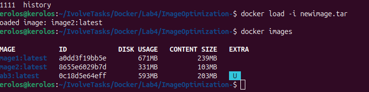

# lab4
# steps
1- mkdir Lab4
2- git clone https://github.com/Ibrahim-Adel15/ImageOptimization-.git
3- cd ImageOptimization-/
4- vim Dockerfile2
FROM maven:3.9.15-eclipse-temurin-17-alpine AS builder

WORKDIR /app

COPY pom.xml .
COPY src ./src

RUN mvn package -DskipTests

FROM eclipse-temurin:17-jre-alpine

WORKDIR /app

RUN addgroup -S appgroup && adduser -S appuser -G appgroup

COPY --from=builder /app/target/demo-0.0.1-SNAPSHOT.jar app.jar

RUN chown appuser:appgroup /app/app.jar

USER appuser

EXPOSE 8080

CMD ["java", "-jar", "app.jar"]

5- docker build -t image2 -f Dockerfile2 .
6- docker images
7- docker run -d --name cont1 -p 8087:8080 image2
8- docker save -o newimage.tar image2
9- docker rmi image2:latest
10- docker load -i newimage.tar 

## Screenshot

 

