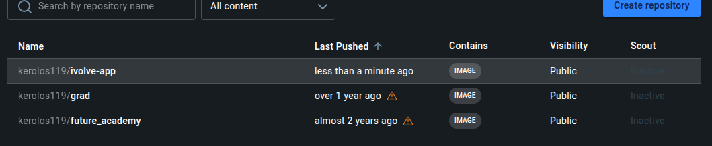

#lab8
# steps

1- mkdir lab8
2- cd lab8/
3- git clone https://github.com/Ibrahim-Adel15/iVolveApp.git
4- cd iVolveApp/
5- sudo apt install docker-compose
6- touch docker-compose.yaml
7- nano docker-compose.yaml 
8- docker compose up -d --build
9- docker logs node-app
10- docker exec node-app env | grep DB_
11- docker exec mysql-db env | grep MYSQL_
12- docker logs node-app --tail 5
13- curl http://localhost:3000/health
14 curl http://localhost:3000/ready

## Screenshot

